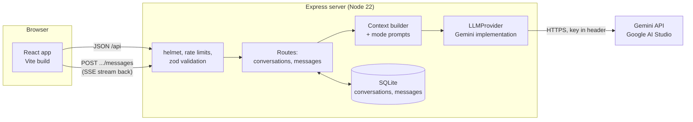

# Next-AI

An AI productivity workspace. Chat with an assistant, or switch into a focused mode to **summarize**, **rewrite**, **explain** or **brainstorm**, with every conversation saved, searchable and organised in a sidebar. It is a full-stack TypeScript app: a React front end, an Express back end, SQLite for storage, and Google's Gemini API as the language model.

> **Naming note:** the interface and the internal package names (`@nexus/server`, `@nexus/client`) use the working title **Nexus AI**. This repository is published as **Next-AI**.

<!-- Add your own screenshots to docs/screenshots/ and link them here. -->
| Empty state (light) | Chat (dark) | Mobile |
| --- | --- | --- |
| _screenshot placeholder_ | _screenshot placeholder_ | _screenshot placeholder_ |

## Table of contents

- [Overview](#overview)
- [Features](#features)
- [Technology stack](#technology-stack)
- [Architecture](#architecture)
- [Project structure](#project-structure)
- [Installation and setup](#installation-and-setup)
- [Environment variables](#environment-variables)
- [API reference](#api-reference)
- [Testing](#testing)
- [Security](#security)
- [Using the Gemini free tier](#using-the-gemini-free-tier)
- [Deployment](#deployment)
- [Troubleshooting](#troubleshooting)
- [Future improvements](#future-improvements)
- [License](#license)

## Overview

### What it is

Next-AI is a self-hosted, single-workspace AI assistant. You type a message, the server sends it (with the relevant earlier messages) to Google's Gemini model, and the reply streams back into the page word by word. Conversations are stored in a local SQLite database, so they survive restarts.

### The problem it solves

General-purpose chatbots mix every kind of task into one long thread. Next-AI gives common writing and learning tasks their own **modes**, each with tailored instructions, and keeps everything organised in a searchable history that **you** host, with an API key that **you** control and that never reaches the browser.

### Who it is for

- Individuals who want a lightweight personal AI workspace they run themselves.
- Developers and students looking for a clear, tested reference for a streaming AI chat app (React + Express + SSE + SQLite).
- Anyone who wants to try the Gemini API on its free tier without paying for anything.

### Practical use cases

- Summarising meeting notes or articles into key points.
- Rewriting emails or paragraphs in a different tone or length.
- Getting programming concepts explained with examples.
- Brainstorming names, ideas and options.
- General Q&A with conversation context.

### How it works, in short

1. The browser (React) sends your message to your own Express server.
2. The server saves it, builds the relevant conversation context, and calls the Gemini API using the secret key from its environment.
3. Gemini's reply is streamed back to the browser as Server-Sent Events and saved when complete.

## Features

### Implemented

| Area | What is implemented |
| --- | --- |
| **AI chat** | Real conversations with Google Gemini through the official `@google/genai` SDK. Earlier messages are sent as context, trimmed to a character budget. |
| **Modes** | Chat, Summarize, Rewrite, Explain and Brainstorm. Each mode is a different system prompt (see `server/src/prompts.ts`). The mode is saved with the conversation. |
| **Streaming** | Replies appear as they are generated. A **Stop** button cancels generation and keeps the partial text. |
| **Conversation management** | Create, rename, delete, and search conversations (search covers titles and message text). Conversations are grouped by Today / Yesterday / Previous 7 days / Older. A new conversation is created on its first message and titled from it. |
| **Persistence** | Conversations and messages are stored in SQLite on the server. |
| **Message actions** | Copy a reply, copy a code block, **Regenerate** the last reply, and **Retry** after a failure. |
| **Rich replies** | Markdown with tables and lists, plus syntax-highlighted code blocks. Raw HTML, `javascript:` links and remote images in AI output are neutralised. |
| **Loading and errors** | Typing indicator, a "still waiting" hint after 6 seconds, and friendly errors for rate limits (with a live retry countdown), exhausted daily quota, invalid key, unsupported region, wrong model name, overload, timeouts, safety-blocked prompts and cut-off replies. |
| **Timeouts and limits** | Server-side stall timeout, browser-side idle timeout, request-size limits, and two layers of rate limiting. Automatic SDK retries are deliberately turned off so free-tier quota is not consumed in the background. |
| **Interface** | Collapsible sidebar, suggested example prompts on the empty state, dark/light theme (remembered in the browser), responsive layout with a mobile drawer, accessible controls and reduced-motion support. |

### Not implemented

- **User accounts or authentication.** There is a single shared workspace. Anyone who can reach the server can use it and read the saved conversations.
- Multi-user data separation, file or image uploads, tool use / function calling, web-search grounding, message editing, and export.
- Automated browser (end-to-end) tests and continuous integration.

## Technology stack

Versions are taken from the `package.json` files.

### Languages and runtime

| Technology | Responsibility |
| --- | --- |
| TypeScript 7 | Language for both front end and back end |
| Node.js 22+ | Server runtime (required by `better-sqlite3`) |
| npm workspaces | Manages the `server/` and `client/` packages from one root |

### Front end (`client/`)

| Technology | Responsibility |
| --- | --- |
| React 19 | UI components and state |
| Vite 8 | Dev server (with an `/api` proxy) and production bundler |
| `react-markdown`, `remark-gfm` | Safe Markdown rendering with GitHub-style tables and lists |
| `rehype-highlight` | Syntax highlighting in code blocks |
| `@fontsource-variable/instrument-sans`, `@fontsource-variable/jetbrains-mono` | Self-hosted fonts (no external font requests) |
| Plain CSS with CSS variables | Styling and the light/dark themes (`client/src/styles.css`) |

### Back end (`server/`)

| Technology | Responsibility |
| --- | --- |
| Express 5 | HTTP API and static file serving |
| `@google/genai` | Official Google Gen AI SDK, used to call the Gemini API with streaming |
| `better-sqlite3` | SQLite database access (synchronous, bundled prebuilt binaries) |
| `zod` | Validation of every request |
| `helmet` | Security headers, including a Content-Security-Policy |
| `express-rate-limit` | Rate limiting |
| `cors` | Only enabled if `CORS_ORIGIN` is set |
| `dotenv` | Loads the root `.env` file |

### Tooling and testing

| Technology | Responsibility |
| --- | --- |
| Vitest 5 | Test runner (back end and front end) |
| Supertest | HTTP-level API tests |
| Testing Library + jsdom | Component tests |
| `tsx` | Runs TypeScript directly in development (auto-restart) |
| `concurrently` | Starts server and client together with one command |

### External services

- **Google Gemini API** (via Google AI Studio): the only external service. It is called **from the server only**.
- No other third-party APIs, analytics or CDNs are used by the application.

## Architecture



### Front end

- `App.tsx` composes the layout; all state and server interaction live in one hook, `hooks/useWorkspace.ts`. Components are mostly presentational.
- `lib/api.ts` wraps `fetch` for the REST calls and for the streaming call. `lib/sse.ts` is an incremental Server-Sent Events parser that copes with events split across network chunks.
- A ref tracks the active conversation so a late response for a conversation you have left cannot appear on the wrong screen.

### Back end

- `app.ts` builds the Express app (security headers, body limit, rate limiters, routes, error handler). In production it also serves the built front end from `client/dist`.
- `routes/conversations.ts` provides CRUD and search; `routes/messages.ts` provides the streaming chat endpoint.
- `db.ts` is the only file that runs SQL, always with bound parameters.
- `llm.ts` defines a small `LLMProvider` interface and its Gemini implementation. Routes depend on the interface, not on Gemini, which also lets tests inject a fake.
- `errors.ts` converts Gemini failures into safe, friendly errors. Raw provider text is never forwarded to the browser.

### Data flow for one message

1. The browser calls `POST /api/conversations/:id/messages` with the text and chosen mode.
2. Middleware validates the request and applies the rate limits.
3. The server **saves the user message first**, then loads the history and trims it to `CONTEXT_CHAR_BUDGET`.
4. The server calls Gemini's `generateContentStream` with the mode's system prompt and the context.
5. Each text fragment is forwarded to the browser as an SSE `delta` event.
6. When generation finishes, the reply is saved and a `done` event is sent. On failure an `error` event carries a friendly message and a `retryable` flag. Any partial text is kept, and **Retry** replaces it.
7. If the browser disconnects (Stop), the server stops reading from Gemini and keeps the partial text.

### AI integration

- The server creates one Gemini client at start-up from `GEMINI_API_KEY`. The key is sent to Google in a request header and is never placed in a URL, response, log line or front-end file.
- A stall timer cancels the call if Gemini sends nothing for `REQUEST_TIMEOUT_MS`, both before the first token and mid-stream.
- The assistant's role is mapped to Gemini's `model` role; mode instructions are passed as the system instruction.
- If a reply hits the length limit, a visible note is appended so a cut-off answer is not mistaken for a complete one.

See [`docs/ARCHITECTURE.md`](docs/ARCHITECTURE.md) for the design decisions in more depth.

## Project structure

```
Next-AI/
├── client/                      React + Vite front end
│   ├── public/                  Favicon and theme-init script (prevents a theme flash)
│   ├── src/
│   │   ├── App.tsx              Layout and composition
│   │   ├── main.tsx             Entry point (fonts, styles)
│   │   ├── styles.css           Design tokens and all styling
│   │   ├── hooks/               useWorkspace (state + streaming), useTheme, useCopy
│   │   ├── components/          Sidebar, ConversationItem, Composer, MessageView,
│   │   │                        Markdown, CodeBlock, EmptyState, ErrorBanner, Icons
│   │   └── lib/                 api client, SSE parser, grouping, modes/examples, theme
│   ├── tests/                   Vitest tests
│   └── vite.config.ts           Dev server, /api proxy, test config
├── server/                      Express API
│   ├── src/
│   │   ├── index.ts             Start-up and graceful shutdown
│   │   ├── app.ts               Express app: security, limits, routes, errors
│   │   ├── config.ts            Reads environment variables
│   │   ├── llm.ts               LLMProvider + Gemini implementation
│   │   ├── prompts.ts           System prompt per mode
│   │   ├── context.ts           Chooses which past messages to send
│   │   ├── db.ts                SQLite schema and queries
│   │   ├── errors.ts            Error classification
│   │   ├── validation.ts        zod schemas
│   │   └── routes/              conversations.ts, messages.ts
│   └── tests/                   Vitest + Supertest tests
├── docs/
│   ├── ARCHITECTURE.md          Design notes
│   └── screenshots/             Placeholder for your screenshots
├── .env.example                 Template for configuration (placeholders only)
├── .npmrc                       Disables dependency install scripts (see Installation)
├── .gitignore
├── package.json                 npm workspaces and top-level scripts
└── LICENSE
```

## Installation and setup

### Prerequisites

- **Node.js 22 or newer** (check with `node -v`). Download from <https://nodejs.org>.
- **Git**.
- A **Google account** to create a free Gemini API key.

### 1. Clone the repository

```bash
git clone https://github.com/<your-username>/Next-AI.git
cd Next-AI
```

### 2. Install dependencies

```bash
npm install
```

One command installs both `server/` and `client/`. A `.npmrc` in the repository sets `ignore-scripts=true`. This is intentional: `better-sqlite3` ships ready-made binaries for Windows, macOS and Linux, but when a lockfile is present npm would otherwise try to compile it from source, which needs Python and C++ build tools and fails on many machines.

### 3. Create a Gemini API key

1. Open <https://aistudio.google.com/apikey> and sign in.
2. Click **Create API key** and choose a project **without billing**.
3. Copy the key and treat it like a password.

### 4. Configure the environment

macOS / Linux:

```bash
cp .env.example .env
```

Windows PowerShell:

```powershell
Copy-Item .env.example .env
```

Open `.env` and replace the placeholder, with no quotes or spaces:

```
GEMINI_API_KEY=your-real-key-here
```

`.env` is git-ignored. Never commit it.

### 5. Run the app (development)

```bash
npm run dev
```

This starts the Express server on port **3001** and the Vite dev server on port **5173**, with `/api` proxied to the server. The terminal should print `AI on, Gemini model ...`. Open <http://localhost:5173>.

You can also run them separately: `npm run dev -w server` and `npm run dev -w client`. Changes to `.env` need a restart.

Quick check: <http://localhost:3001/api/health> should report `"aiConfigured":true`. It never shows the key.

### 6. Production build

```bash
npm run build     # builds client/dist and server/dist
npm start         # serves the API and the built front end on one port (default 3001)
```

### Scripts

| Command | What it does |
| --- | --- |
| `npm run dev` | Server and client together, with auto-restart |
| `npm run build` | Type-checks and builds the client, then compiles the server |
| `npm start` | Runs the built server (also serves `client/dist`) |
| `npm test` | Runs back-end then front-end tests |
| `npm run typecheck` | TypeScript checks for both packages |

## Environment variables

All variables are read by the server from the **root** `.env` file. See [`.env.example`](.env.example) for the full annotated template. No real values belong in this repository.

| Variable | Default | Purpose |
| --- | --- | --- |
| `GEMINI_API_KEY` | none | **Required for AI replies.** Server-side only. A leftover placeholder is detected and ignored. |
| `GEMINI_MODEL` | `gemini-3.5-flash-lite` | Which Gemini model to call |
| `PORT` | `3001` | Server port |
| `MAX_OUTPUT_TOKENS` | `4096` | Maximum reply length (includes the model's internal reasoning tokens) |
| `REQUEST_TIMEOUT_MS` | `30000` | Give up if Gemini sends nothing for this long |
| `CHAT_RATE_LIMIT_PER_MINUTE` | `8` | Max chat messages per minute per IP |
| `DATABASE_PATH` | `data/nexus.db` | SQLite file (relative paths resolve from the project root) |
| `CONTEXT_CHAR_BUDGET` | `48000` | Max characters of earlier conversation sent each turn |
| `MAX_MESSAGE_CHARS` | `12000` | Max size of one user message |
| `TRUST_PROXY` | `false` | Set `true` behind a proxy so rate limiting sees real client IPs |
| `CORS_ORIGIN` | unset | Only needed if the front end is hosted on a different domain |

## API reference

All routes are under `/api` and return JSON, except the streaming endpoint.

| Method and path | Purpose |
| --- | --- |
| `GET /api/health` | Status, whether AI is configured, model name, max message size |
| `GET /api/conversations?q=` | List conversations, optionally searching titles and message text |
| `POST /api/conversations` | Create a conversation |
| `GET /api/conversations/:id` | Get a conversation with its messages |
| `PATCH /api/conversations/:id` | Rename a conversation |
| `DELETE /api/conversations/:id` | Delete a conversation and its messages |
| `POST /api/conversations/:id/messages` | Send a message (or `regenerate: true`) and receive the reply as SSE events `delta`, `done` or `error` |

Errors use one shape: `{ "error": { "code", "message", "retryable" } }`.

## Testing

Tools: **Vitest**, **Supertest** (HTTP tests), and **Testing Library with jsdom** (components).

```bash
npm test              # all tests
npm run test -w server
npm run test -w client
npm run typecheck
```

**Verified results** (Node 22.23.5, run on 21 Nov 2026 from a clean `npm ci`):

| Check | Result |
| --- | --- |
| Back-end tests | 42 passed (5 files) |
| Front-end tests | 19 passed (4 files) |
| `npm run typecheck` | No errors |
| `npm run build` | Succeeds |

What the tests cover: conversation CRUD and search, validation and size limits, rate limiting, SSE streaming, context building, retry/regenerate, the Gemini provider (roles, system prompt, stall timeouts, Stop, blocked and cut-off replies), error classification, configuration handling, the SSE parser, the streaming client, the retry countdown, conversation grouping, theme logic and Markdown safety.

**Important:** the tests use fakes and **never call Google**, so they use none of your quota. They therefore do not prove that your key works. Sending your first real message is the end-to-end check.

## Security

- **The API key stays on the server** and is read from the environment. It is sent to Google in a request header only.
- Every request is **validated** (zod); JSON bodies are capped at 64 KB and messages at `MAX_MESSAGE_CHARS`.
- **Rate limiting:** 120 requests per minute per IP overall, and `CHAT_RATE_LIMIT_PER_MINUTE` chat messages per minute per IP.
- **Safe rendering** of AI output (no raw HTML, no `javascript:` links, no remote images) and **parameterised SQL** throughout.
- **Helmet** security headers including a Content-Security-Policy.
- Provider errors are **mapped to friendly messages** and never echoed.
- **Limitation:** there is no authentication. Do not expose an instance to the public internet without adding a login, because visitors could read saved conversations and use your Gemini quota.

## Using the Gemini free tier

This project is designed to run on Google's free tier, with no paid dependency.

- Google's pricing page lists `gemini-3.5-flash-lite` (the default) among models with a free tier. Check the **Free Tier** column at <https://ai.google.dev/gemini-api/docs/pricing> before changing `GEMINI_MODEL`.
- Free-tier limits (requests per minute, tokens per minute, requests per day) are **per Google project**, differ by model, can change, and are shown in AI Studio. The daily limit resets at midnight Pacific time.
- When a limit is exceeded Gemini refuses the request and the app shows a clear message (a countdown for per-minute limits; an explanation for the daily limit). Nothing is charged, and the app never falls back to a paid service.
- **On the free tier, Google may use your content to improve its products.** Do not send confidential or personal data.
- Do not enable Cloud Billing on the key's project if you want to stay on the free tier.
- Every message, Retry and Regenerate counts as one request.

## Deployment

The production build is a single Node service (`npm run build`, then `npm start`) that serves both the API and the front end.

- Set `GEMINI_API_KEY` and `TRUST_PROXY=true` as environment variables on your host, and use Node 22.
- SQLite is a file. Most hosts wipe the disk on each deploy, so mount a persistent volume and point `DATABASE_PATH` at it, or history will reset.
- Because there is no authentication and the free quota is shared by everyone who can reach the app, add a login before sharing the URL.

## Troubleshooting

- **`npm` is not recognized:** reinstall Node.js and reopen the terminal.
- **Terminal says "AI off" or "still the placeholder":** `GEMINI_API_KEY` is missing or unchanged. The file must be named exactly `.env`, sit in the project root, and the server must be restarted.
- **"Gemini rejected the server's API key":** wrong or deleted key, or stray spaces. Create a new one.
- **"free API isn't available from your location":** Google restricts the free tier in some regions.
- **"couldn't find the configured model":** fix `GEMINI_MODEL`.
- **Timeouts or cut-off replies:** raise `REQUEST_TIMEOUT_MS` or `MAX_OUTPUT_TOKENS`.
- **Port already in use:** change `PORT` in `.env` and the proxy target in `client/vite.config.ts`.

## Future improvements

None of these are implemented yet:

- Authentication and per-user data separation.
- A database such as PostgreSQL for multi-instance deployments.
- Token-accurate context trimming, and summarising of old turns.
- AI-generated conversation titles.
- A model picker and optional automatic fallback to another free model when a daily quota runs out.
- Usage and quota display in the interface.
- Export of conversations.
- Browser end-to-end tests and a CI workflow (for example GitHub Actions) that runs typecheck, tests and build.

## License

Released under the MIT License. See [LICENSE](LICENSE).

## Telegram bot integration

The optional Telegram integration runs on the same Express service as the web app. It uses the existing Gemini provider and stores Telegram user histories separately in Neon PostgreSQL (`telegram_users`, `telegram_messages`). Only private Telegram chats are supported; group chats are asked to switch to a private chat.

Configure these server environment variables in Render:

- `TELEGRAM_BOT_TOKEN`: token from @BotFather (keep private).
- `TELEGRAM_WEBHOOK_SECRET`: random 32-256 character value containing only letters, digits, `_` or `-`.

When both values are configured and `DATABASE_URL` points to Neon, the server creates the Telegram schema during startup, exposes `POST /api/telegram/webhook` before website Basic Auth, validates Telegram's `X-Telegram-Bot-Api-Secret-Token` header, and starts a PostgreSQL-backed update worker. The worker is idempotent for duplicate Telegram update IDs and limits each user using `CHAT_RATE_LIMIT_PER_MINUTE`.

To register the webhook from a trusted local machine, add the same `TELEGRAM_BOT_TOKEN` and `TELEGRAM_WEBHOOK_SECRET` to the root `.env` temporarily (never commit or share `.env`), set `TELEGRAM_WEBHOOK_URL` to `https://<your-render-service>/api/telegram/webhook`, then run:

```bash
npm run telegram:set-webhook -w server
```

The script prints the webhook URL but never prints the token or secret. You can then remove the two Telegram secrets from your local `.env`; keep them in Render's Environment settings.

Supported commands: `/start`, `/help`, `/reset`. Normal text messages are sent to Gemini with the user's recent Telegram history. Telegram histories are separate from the shared web demo workspace.
