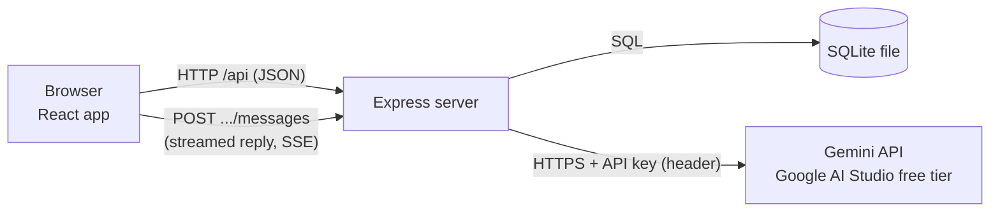

# Architecture

## The big picture

Why a server at all? Your API key is a password tied to your Google project's quota (and to your bill, if you ever enable billing). If the React app called Gemini directly, the key would be visible in the browser's network tab to anyone. So the browser calls **your** server, and only the server knows the key.

## One chat message, step by step

1. You press Enter. `useWorkspace.send()` (client) creates the conversation if this is the first message, shows your message immediately, and calls `streamMessage()`.
2. `POST /api/conversations/:id/messages` reaches Express. Middleware runs in order: Helmet (headers) → JSON body parser (64 KB cap) → rate limiters → zod validation.
3. The server **saves your message first**, then loads the history, trims it to the size budget (`context.ts`), and adds the system prompt for the chosen mode (`prompts.ts`).
4. `llm.ts` calls Gemini's `generateContentStream()` (via the official `@google/genai` SDK). Each text fragment is forwarded to the browser as an SSE event (`event: delta`).
5. When the model finishes, the server saves the full reply and sends `event: done`. If something fails, it sends `event: error` with a friendly message, a `retryable` flag and, for rate limits, a wait time.
6. The browser's `SSEParser` turns the byte stream back into events, and the UI appends text as it arrives.

## Decisions, explained

**Server-Sent Events instead of WebSockets.** Chat replies flow one way (server → browser) after a normal request. SSE is just a long-lived HTTP response, works with ordinary `fetch`, needs no extra library, and is simpler to secure and deploy. WebSockets would add complexity we don't need. (We use `fetch` + a stream reader rather than the browser's `EventSource` because `EventSource` can't send a POST body.)

**An `LLMProvider` interface (`llm.ts`).** The rest of the server only knows "something that streams text". Gemini is one implementation. (Because of this, swapping the AI provider only touched the provider file, the error mapper and the config. The routes, database and UI stayed the same.) It also lets tests use a fake model.

**Modes are system prompts.** Summarize, Rewrite, Explain and Brainstorm don't need different models, only different instructions. The mode is sent with each message and saved on the conversation.

**Context = the most recent messages that fit.** Models can only read so much text per request, and every token costs money. `buildContext()` walks backwards from the newest message, keeps what fits `CONTEXT_CHAR_BUDGET`, merges accidental back-to-back user messages (which happen after a failed request), and makes sure the list starts with a user message as the API requires. The newest message is always kept.

**SQLite via `better-sqlite3`.** A single file, no database server to install, synchronous and fast. Perfect for local use and single-instance deployments. All SQL lives in `db.ts`, so moving to Postgres later touches one file.

**Conversations are created lazily.** Pressing "New conversation" only clears the screen. The record is created when you send the first message, so you never accumulate empty chats.

**Save before generating; keep partial output.** Your message is stored before the model runs, so a failure never loses it. If a reply breaks mid-way, the partial text is kept and **Retry** replaces it (`regenerate: true` re-runs the last user turn). If the request failed before the server accepted it, Retry resends the original text instead; the client tracks which case applies.

**Stop button.** Stop aborts the browser request. The server notices the closed connection, stops reading from Gemini, and keeps the partial text. Note that Google's SDK documents aborting as a *client-side* action that doesn't cancel the request inside Google's service, so a stopped request can still count toward your free quota.

**Errors are translated (`errors.ts`).** Gemini failures become short messages with a `code` and `retryable` flag. The mapper tells apart a *per-minute* limit (wait and retry; Gemini says how long) from an exhausted *daily* quota (no point retrying until midnight Pacific), a bad key, an unsupported region, a wrong model name, overload, timeouts and blocked content. Raw provider text is read only to classify the error and is never forwarded, since it can reveal internals.

**Two timeouts, and no hidden retries (`llm.ts`).** We cancel the call if Gemini sends nothing for `REQUEST_TIMEOUT_MS`, both before the first word and in the middle of a reply (a "stall" timer that resets whenever data arrives). The browser has its own, slightly longer, idle timer as a backstop. Google's SDK retries failed calls up to 5 times by default; we turn that off because on a free tier each hidden retry consumes quota and freezes the UI. Retrying is a visible, user-controlled button instead.

**Our own rate limit sits in front of Google's.** `CHAT_RATE_LIMIT_PER_MINUTE` stops bursts before they reach Gemini, so a double-click doesn't spend two requests from a small free quota.

**Cut-off and blocked replies are never silent.** If a reply hits the length limit, a visible note is appended so it isn't mistaken for a complete answer. If Gemini's safety filters block a prompt, you get a clear explanation instead of an empty message.

**Safe Markdown (`Markdown.tsx`).** AI output is untrusted input. `react-markdown` builds React elements (never `innerHTML`), we don't enable raw HTML, links are filtered and opened with `noopener`, and images are replaced by their alt text.

**State lives in one hook.** `useWorkspace` owns conversations, messages, streaming and errors. Components are mostly display-only. A ref tracks the active conversation so a late response for a conversation you've left can't appear in the wrong one.

## Where to change things

| I want to… | Edit |
| --- | --- |
| Change how a mode behaves | `server/src/prompts.ts` |
| Switch model | `GEMINI_MODEL` in `.env` |
| Change rate limits | `server/src/app.ts` |
| Add an API route | `server/src/routes/` + `validation.ts` |
| Change colors / fonts | CSS variables at the top of `client/src/styles.css` |
| Add example prompts | `client/src/lib/modes.ts` |
